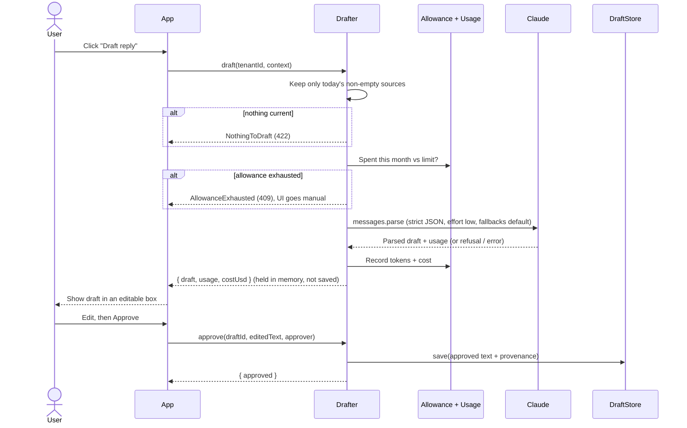

# claude-approval-drafts

Approval-gated AI drafts with Claude. The model writes a draft, a person edits and approves it, and only then is anything saved.

Adding "Draft with AI" to a product is easy. Adding it safely to a multi-tenant product is harder. The draft has to come from the record in front of the user, not from the model's imagination. One tenant must not be able to run up an unbounded bill. Customer data must stay out of logs. A model refusal or malformed output has to reach the UI as a state it can handle, not as a crash. Nothing should reach your database until a person has read it. This library is a small, framework-free implementation of that pattern for TypeScript, built on the official `@anthropic-ai/sdk`. It ships with in-memory stores, a runnable support-ticket example, and tests that all run without an API key.

## The six rules it enforces

1. **Today's data only.** Drafts are built only from sources recorded today. If there are none, `draft()` returns `NothingToDraft` (HTTP 422) and makes no API call.
2. **Metered and capped.** Each tenant's monthly allowance is checked before the call. When it is spent, `draft()` returns `AllowanceExhausted` (409) and your UI falls back to manual writing. Every response is recorded in a usage store with its tokens and cost, including refusals and bad output.
3. **Strict output.** Claude must return JSON matching a zod schema, using structured outputs. Refusals, truncation and schema mismatches come back as a typed `ProviderError`, never as text pasted into the editor.
4. **A human approves every save.** `draft()` writes nothing. `approve(draftId, editedText, approver)` is the only code path that calls `DraftStore.save()`.
5. **No bodies in logs.** Every log line goes through a safe logger that only passes allowlisted metadata keys with plain (scalar) values. Errors carry an HTTP status and a truncated provider message, never the prompt or the output.
6. **Keyless in dev, loud in prod.** Without credentials, dev and test get a deterministic, clearly labelled canned draft, so end-to-end tests run without a key. In production, missing credentials throw when the drafter is created at boot. The service never silently does nothing.

## How a draft flows



## Install and use

```bash
npm install github:<your-account>/claude-approval-drafts @anthropic-ai/sdk zod
```

```ts
import {
  createDrafter,
  InMemoryAllowanceStore,
  InMemoryDraftStore,
  InMemoryUsageStore,
} from "claude-approval-drafts";

const drafter = createDrafter({
  model: "claude-opus-5-5",
  instructions: "You draft replies to support tickets for Northwind Kettles. Warm, brief, no promises the records don't support.",
  allowance: new InMemoryAllowanceStore({ "tenant-1": 5.0 }), // USD per month
  usage: new InMemoryUsageStore(),
  drafts: new InMemoryDraftStore(),
  logger: console, // always wrapped in the safe logger
  // client: new Anthropic({...}) // optional; otherwise built from ANTHROPIC_API_KEY
});

const result = await drafter.draft("tenant-1", {
  subjectId: "TICKET-48213",
  sources: [
    { label: "Customer message", text: "My order hasn't moved in 4 days...", recordedAt: new Date() },
    { label: "Order record", text: "Order NK-20931, label created, no carrier scan...", recordedAt: new Date() },
  ],
});

if (!result.ok) {
  // result.error.code: "nothing_to_draft" | "allowance_exhausted" | "provider_error"
  // result.error.httpStatus: 422 | 409 | 502 | 503
  return respond(result.error.httpStatus, { code: result.error.code });
}

showEditor(result.draft.draftId, result.draft.output.body, result.draft.output.missing_info);

// Later, when the person clicks Approve:
const saved = await drafter.approve(draftId, editedText, currentUser.id, { tenantId: "tenant-1" });
```

In a real app, replace the three in-memory stores with your own tables. The interfaces are in [`src/types.ts`](src/types.ts) and each has one or two methods.

Run the example and the tests:

```bash
npm install
npm run example        # keyless canned draft; set ANTHROPIC_API_KEY for a live call
npm test               # vitest, no key needed
npm run typecheck
```

## Claude API details

- Model `claude-opus-5-5`, called through `client.beta.messages.parse` with `output_config.format: betaZodOutputFormat(schema)`.
- `output_config.effort: "low"`. Opus 5.5 always thinks, and effort is the only way to control how much. Writing a short reply from facts already in the prompt is a bounded rewrite, so low effort keeps the button fast and cheap. Raise it to `"medium"` only if an eval shows low effort misses facts.
- `fallbacks: "default"` with beta `server-side-fallback-2026-07-01`. If a safety classifier declines the request, the API re-runs it on Anthropic's recommended fallback model within the same call. The cost is calculated per attempt from `usage.iterations`, at each model's own rate.
- The code checks `stop_reason` before it reads content. A `"refusal"` (after any fallback) becomes `ProviderError{kind: "refusal"}` with the `stop_details.category`.
- SDK errors are mapped with an `instanceof` chain, from most specific to least: Auth/PermissionDenied, BadRequest/NotFound/Unprocessable, RateLimit, InternalServer, APIConnection, then APIError. The code never matches on error message text.
- When the library builds the client itself, it pins the SDK's `logLevel` to `"warn"`. Otherwise an `ANTHROPIC_LOG=debug` environment variable would make the SDK log full request and response bodies.

Prices used for allowance accounting (USD per million tokens): Opus 5.5 is $4 input, $20 output and $0.20 for cache reads. Cache writes cost 1.25x the input price for the 5-minute TTL and 2x for the 1-hour TTL. The table also has rates for the fallback models. See [`src/pricing.ts`](src/pricing.ts).

## Prompt caching: measure, don't assume

The system prompt carries a `cache_control` marker, but **in the example the marker does nothing.** Read this before you trust a cache marker anywhere.

Prompt caching only applies when the cached prefix is at least the model's minimum cacheable length. For Claude Opus 5.5, Anthropic's prompt caching guide gives that minimum as 512 tokens. Below it, the API ignores the marker without an error. You pay no cache-write premium and get no cache reads, and both `usage.cache_creation_input_tokens` and `usage.cache_read_input_tokens` stay at 0. The example's system prefix (instructions plus output rules) is about 1,240 characters. At a rough 4 characters per token, that is about 310 tokens. The structured-output schema adds some tokens to the rendered prompt, and the docs don't say how many. That uncertainty is why the honest status is "probably inert, measure it", not "cached".

How to check:

1. Run `ANTHROPIC_API_KEY=... npm run example`. Step 5 sends the same prefix twice and prints `cache_write` and `cache_read` for both calls.
2. If both stay at 0, the prefix is below the minimum and the marker is inert.
3. Every usage record in the library stores `cacheReadTokens` and `cacheWriteTokens`, so you can watch the same numbers in production.

Why keep the marker if it does nothing? It costs nothing while inert. If your instructions grow past the minimum, caching switches on with no code change. And because only static text goes in the system block (customer data stays in the user message), the prefix is byte-identical across tenants, so one cache entry serves them all. Don't pad the prompt just to reach the minimum. At this size the most you can save is about a tenth of a cent per call, and each cold write costs 1.25x the input price. Decide from the measured numbers, not from the presence of a marker.

## What is not covered

- The pending-draft cache lives in process memory. Drafts expire after an hour, and if you run more than one instance you need sticky sessions or a shared cache. Pending drafts are deliberately never written to your database.
- The price table is hand-maintained. If a model is missing, `costUsd` is recorded as `null` and a `pricing.unknown_model` warning is logged. Its tokens are still recorded.
- The tests mock Claude at the HTTP transport level, using the real SDK client and parser. Live behaviour (actual drafts, refusals, fallbacks, cache numbers) needs a key.

## Origin

Extracted from an approval-gated AI feature I built and shipped in a multi-tenant SaaS.

## License

MIT, see [LICENSE](LICENSE).
